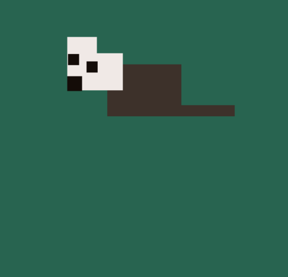
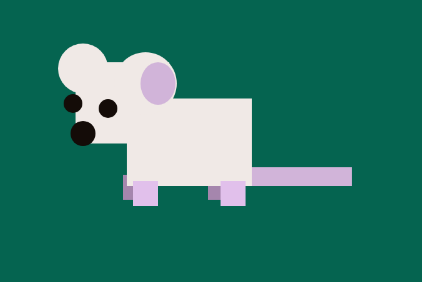
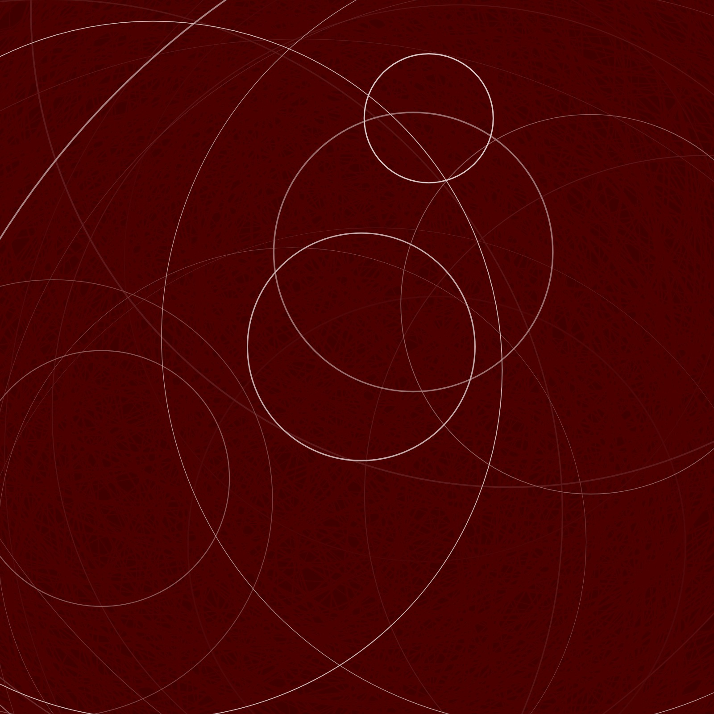

# Week 01 — Introduction to Creative Coding

<!-- Replace ## with the week number and Topic Name with the week's focus -->
<!-- You may also refer to each week's slide for the Topic Name -->
<!-- e.g. Week 03 — Arrays & Functions -->

---

### Activities

| Activity | What I Made                   |
| -------- | ----------------------------- |
| `1a`     | A white rat made using rectangles and ellipses |
| `1b`     | Cool ellipse and rectangle animations |

<!-- Add or remove rows to match the activities for this week. -->

---

### This Week

<!-- A short, informal summary of what you explored across the week's activities. What did you make? What clicked? What didn't?
     A few sentences is all you need — write it like a journal entry, not a report. -->

Activity 1a was a fun introduction to drawing using code. I made a rat because they're really cute. One thing I struggled with is knowing what coordinates to type, to place the body parts relative to the body. I had to keep changing the numbers and refreshing the sketch to see if placed them correctly.

For activity 1b I chose to build on Georg Nees. It's interesting that just reducing the opacity of the shapes being drawn can easily give the animation such a cool fading effect. I also tried editing the Ryoji Ikeda sample as I had extra time.

---

### Output

1a — Simple Creatures


first attempt haha




1b — Learning by Making


.jpg)

.jpg)

.jpg)

.jpg)

.jpg)

.jpg)

.jpg)

.jpg)

.jpg)

.jpg)


<!-- Drop a screenshot, photo, or GIF of something you made this week.
     Save it to a readme-assets/ folder inside this week's folder.
     Made more than one thing worth showing? Add more images. -->

---

<!-- ─────────────────────────────────────────────────────
     GOING FURTHER — if you want to document more, here are some ideas:

     ### 1a — Activity Name
     
     What you tried, what you discovered.

     ### 1b — Activity Name
     
     What you tried, what you discovered.

     ### 🧩 Something I Found Interesting
     A line of code, a technique, a happy accident — paste it here.
     ```js
     // your code here
     ```

     ### ❓ Questions I'm Sitting With
     Anything unresolved, something you want to revisit, or a rabbit hole you fell into.

     ### 🔗 References
     Links to anything that helped or inspired you this week.
     ───────────────────────────────────────────────────── -->
