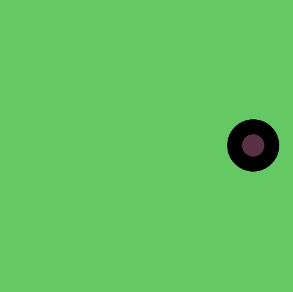

# Week 02 — Conditionals & Loops

<!-- Replace ## with the week number and Topic Name with the week's focus -->
<!-- You may also refer to each week's slide for the Topic Name -->
<!-- e.g. Week 03 — Arrays & Functions -->

---

### Activities

| Activity | What I Made                   |
| -------- | ----------------------------- |
| `2a`     | Backgrounds and ellipse that changed with the key pressed  |
| `2b`     | Yellow spine that turns into marrow |

<!-- Add or remove rows to match the activities for this week. -->

---

### This Week

<!-- A short, informal summary of what you explored across the week's activities. What did you make? What clicked? What didn't?
     A few sentences is all you need — write it like a journal entry, not a report. -->

 This week I learned how to set variables before the set up e.g "let c;" Then "c = colour(hexcode)" to tie a colour to the letter c
 Also to keep a shape centered in a setup, use "(width/2, height/2)" instead of having to constantly do math and change the values.

Activity 2a was slightly more difficult than last week where we simply drew shapes. This time there is some math involved, like  "if (x > width + size / 2) { x = 0; }" and it takes some time for my brain to figure out what the code does. I learned about if/else, function keyPressed and mouseIsPressed which were quite easy to grasp.

For 2b, I practiced using a for loop which I think will be really handy if I want to create a grid or pattern instead of writing the same code over and over. At first I didn't know what exactly I was gonna make but as I offset each row of shapes I ended up creating an interesting spine. 


---

### Output

2a — Mode Switch




2b — Pattern Making

.png)

.png)

.png)


<!-- Drop a screenshot, photo, or GIF of something you made this week.
     Save it to a readme-assets/ folder inside this week's folder.
     Made more than one thing worth showing? Add more images. -->

---

<!-- ─────────────────────────────────────────────────────
     GOING FURTHER — if you want to document more, here are some ideas:

     ### 1a — Activity Name
     
     What you tried, what you discovered.

     ### 1b — Activity Name
     
     What you tried, what you discovered.

     ### 🧩 Something I Found Interesting
     A line of code, a technique, a happy accident — paste it here.
     ```js
     // your code here
     ```

     ### ❓ Questions I'm Sitting With
     Anything unresolved, something you want to revisit, or a rabbit hole you fell into.

     ### 🔗 References
     Links to anything that helped or inspired you this week.
     ───────────────────────────────────────────────────── -->
