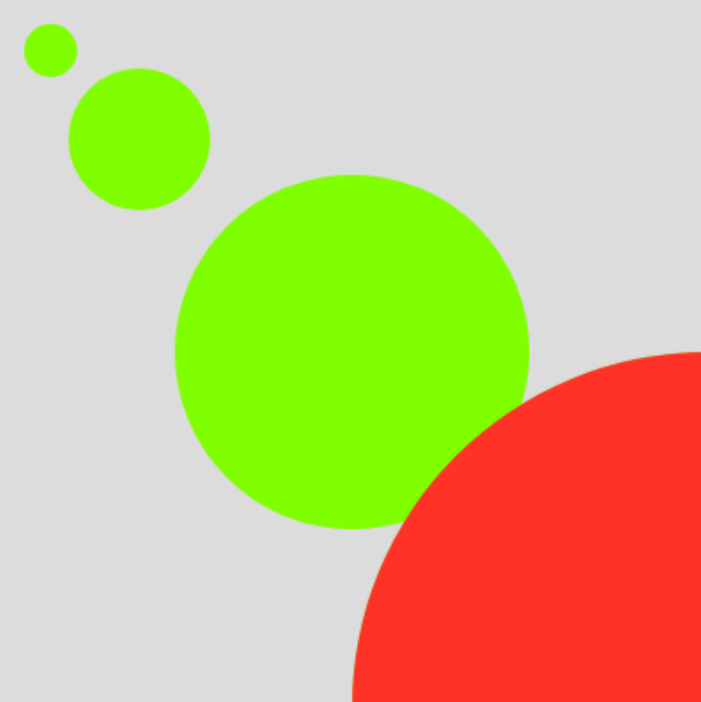
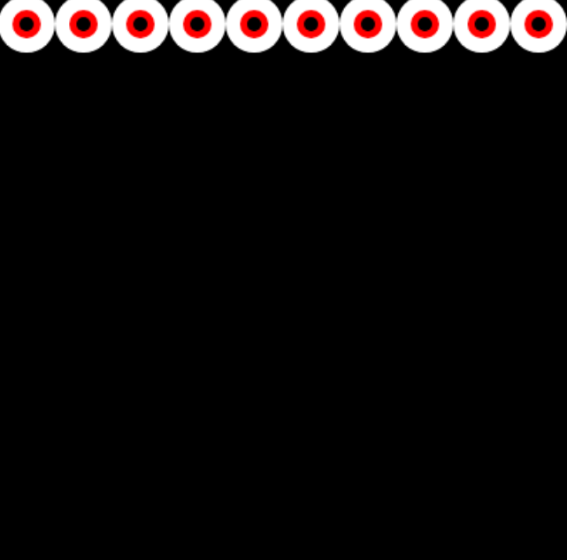

# Week 03 — Arrays, Functions & Transformations

<!-- Replace ## with the week number and Topic Name with the week's focus -->
<!-- You may also refer to each week's slide for the Topic Name -->
<!-- e.g. Week 03 — Arrays & Functions -->

---

### Activities

| Activity | What I Made                   |
| -------- | ----------------------------- |
| `3a`     |  Green ellipses lined up, highlighted with red one by one |
| `3b`     | Grid of eyeballs |

<!-- Add or remove rows to match the activities for this week. -->

---

### This Week

<!-- A short, informal summary of what you explored across the week's activities. What did you make? What clicked? What didn't?
     A few sentences is all you need — write it like a journal entry, not a report. -->

This week I learned about arrays. They are defined before the setup, to group variables that can be pulled out and used quickly. They are numbered starting from 0, so the first item in an array is labelled 0, not 1.

For activity 3a, I created 2 arrays. I wanted to have variation in both the size and color of the shapes.
While experimenting with push(), I added a random size to the array each time a key was pressed. Because each ellipse's x, y, and size are tied to the same value in my array, every new circle landed on the diagonal and nested inside the others. This created an illusion of the red ellipse travelling through a tunnel (seen in the second video)

I learned about functions which are like recipes that make it easier to duplicate assets and change their variables, so draw doesn't get cluttered.
Now I just need to duplicate the function to create more!

In 3b I created a simple eyeball shape function and put it in a for loop which made a row of it. 
Kapi showed us how to create a grid by putting it within another loop that duplicates that row. Something I still struggle with is understanding the math...


---

### Output

3a — Array Sampler

.png)



.png)
.mp4)


3b — One Function Wonder


.png)


<!-- Drop a screenshot, photo, or GIF of something you made this week.
     Save it to a readme-assets/ folder inside this week's folder.
     Made more than one thing worth showing? Add more images. -->

---

<!-- ─────────────────────────────────────────────────────
     GOING FURTHER — if you want to document more, here are some ideas:

     ### 1a — Activity Name
     
     What you tried, what you discovered.

     ### 1b — Activity Name
     
     What you tried, what you discovered.

     ### 🧩 Something I Found Interesting
     A line of code, a technique, a happy accident — paste it here.
     ```js
     // your code here
     ```

     ### ❓ Questions I'm Sitting With
     Anything unresolved, something you want to revisit, or a rabbit hole you fell into.

     ### 🔗 References
     Links to anything that helped or inspired you this week.
     ───────────────────────────────────────────────────── -->
