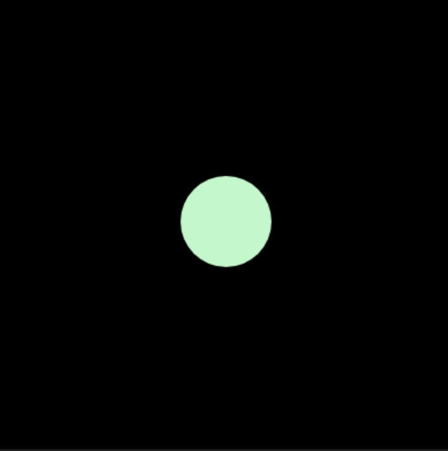
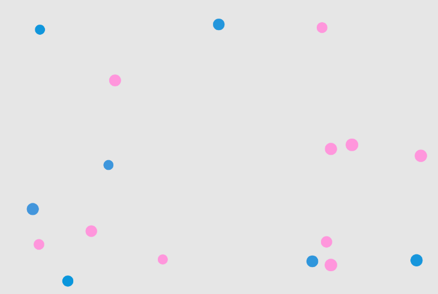

# Week 04 — Blueprints & Objects

<!-- Replace ## with the week number and Topic Name with the week's focus -->
<!-- You may also refer to each week's slide for the Topic Name -->
<!-- e.g. Week 03 — Arrays & Functions -->

---

### Activities

| Activity | What I Made                   |
| -------- | ----------------------------- |
| `4a`     | 4 flavour cookie |
| `4b`     |  Flashing bouncy balls  |

<!-- Add or remove rows to match the activities for this week. -->

---

### This Week

<!-- A short, informal summary of what you explored across the week's activities. What did you make? What clicked? What didn't?
     A few sentences is all you need — write it like a journal entry, not a report. -->
This week I learned that objects in a game can be thought of as a 'guy' with properties (stats) and methods (actions): a group of related data that's packaged
- A Class = template for creating objects 
- It is first named using UpperCamelCase (first letter is capitalized)
- Every class begins with a constructor ( ) which defines the initial properties or 'shape'

In activity 4a I tested out classes by creating a cookie class which changes its flavor/colour when the mouse is pressed, by calling cookie.randomFlavor(). calling that method picks a random word in this.flavor's array. It was quite confusing to keep jumping here and there and I kept mixing them up.

4b was a lot trickier and I had to rely a lot on my classmate to complete it. I recalled my knowledge of loops and learned how to animate my classes in draw by calling move() in draw to update their properties as draw runs.


---

### Output

4a — Bake a Cookie


.png)
.png)
.png)


4b — Objects in Motion


.png)


<!-- Drop a screenshot, photo, or GIF of something you made this week.
     Save it to a readme-assets/ folder inside this week's folder.
     Made more than one thing worth showing? Add more images. -->

---

<!-- ─────────────────────────────────────────────────────
     GOING FURTHER — if you want to document more, here are some ideas:

     ### 1a — Activity Name
     
     What you tried, what you discovered.

     ### 1b — Activity Name
     
     What you tried, what you discovered.

     ### 🧩 Something I Found Interesting
     A line of code, a technique, a happy accident — paste it here.
     ```js
     // your code here
     ```

     ### ❓ Questions I'm Sitting With
     Anything unresolved, something you want to revisit, or a rabbit hole you fell into.

     ### 🔗 References
     Links to anything that helped or inspired you this week.
     ───────────────────────────────────────────────────── -->
