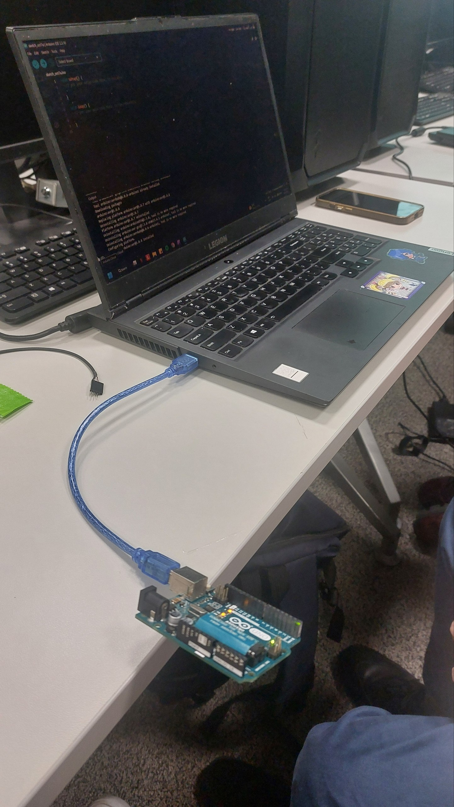
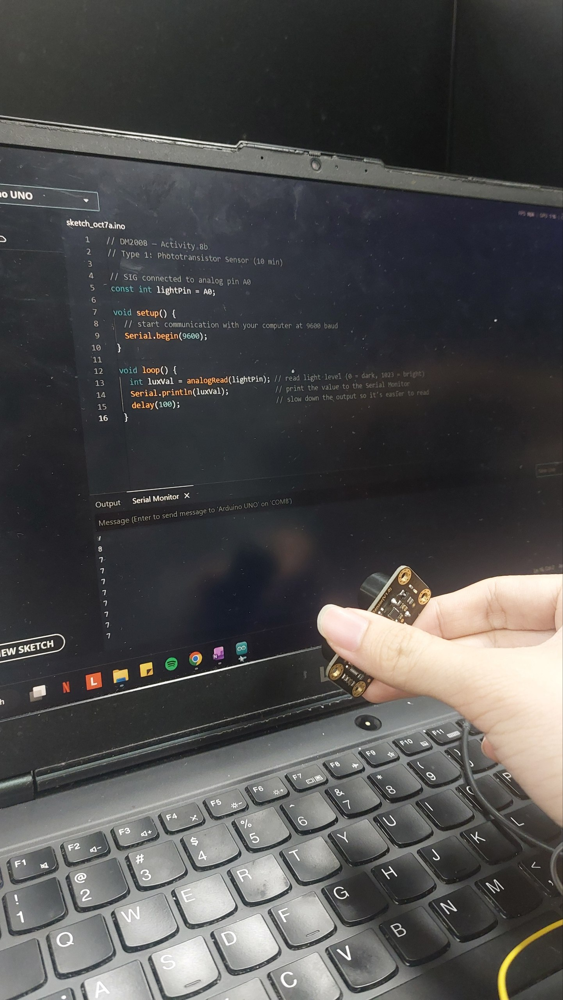

# Week 08 — Arduino Basics

<!-- Replace ## with the week number and Topic Name with the week's focus -->
<!-- You may also refer to each week's slide for the Topic Name -->
<!-- e.g. Week 03 — Arrays & Functions -->

---

### Activities

| Activity | What I Made                   |
| -------- | ----------------------------- |
| `8a`     | LED setups  |
| `8b`     | Sensor setups |

<!-- Add or remove rows to match the activities for this week. -->

---

### This Week

<!-- A short, informal summary of what you explored across the week's activities. What did you make? What clicked? What didn't?
     A few sentences is all you need — write it like a journal entry, not a report. -->

This week I learned about the anatomy of an arduino board, the functions of each pin:

Digital pins: ON/OFF
Power pins: Give electricity to sensors and LEDs
Analog pins: A range, A0-A5

p5.js and Arduino follow the same same but different logic e.g p5.js's function setup() is Arduino's void setup()

In 8a I explored how to wire a breadboard and arduino, and the different ways to control an LED
8b was very interesting as I got to use sensors that detected things like light and proximity to an object. It was cool to watch them respond to my movements 


---

### Output
Activity 8a - Power & control LEDs



.jpg)


.mp4)


Activity 8b - Sensor Check



.jpg)

.jpg)


<!-- Drop a screenshot, photo, or GIF of something you made this week.
     Save it to a readme-assets/ folder inside this week's folder.
     Made more than one thing worth showing? Add more images. -->

---

<!-- ─────────────────────────────────────────────────────
     GOING FURTHER — if you want to document more, here are some ideas:

     ### 1a — Activity Name
     
     What you tried, what you discovered.

     ### 1b — Activity Name
     
     What you tried, what you discovered.

     ### 🧩 Something I Found Interesting
     A line of code, a technique, a happy accident — paste it here.
     ```js
     // your code here
     ```

     ### ❓ Questions I'm Sitting With
     Anything unresolved, something you want to revisit, or a rabbit hole you fell into.

     ### 🔗 References
     Links to anything that helped or inspired you this week.
     ───────────────────────────────────────────────────── -->
