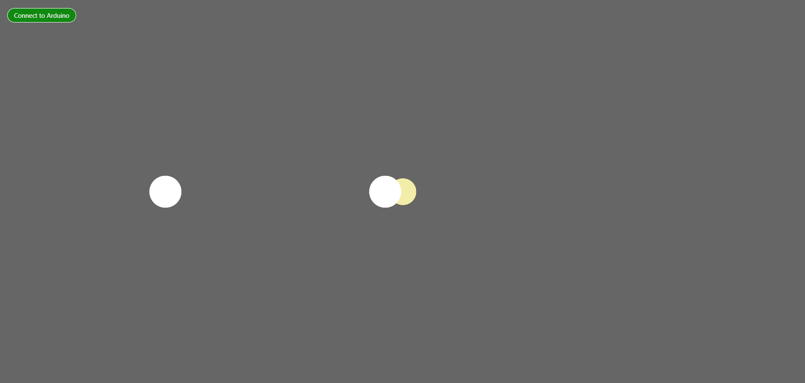

# Sensor Jam — Thumping Ellipses

<!-- Replace "Title" with the name of your project, e.g. "Sensor Jam — Theremin Visualiser" -->

---

### The Project

<!-- What does your sketch do, and what physical input drives it?
     How does the sensor data translate into something on screen?
     A few sentences is all you need. -->
Initially, Isaac, Soonyu and I wanted to make a pufferfish that expands and deflates depending on your hand's proximity to the ultrasonic sensor. We didn't have time to create the features but managed to make a cool fade effect by setting the ellipse opacity to 50.


---

### Output



.png)

<!-- Drop a screenshot or GIF of your sketch in action.
     Got a photo of your physical setup too? Throw it in.
     Save everything to a readme-assets/ folder inside this project folder. -->

[Watch Online](https://youtu.be/8PRv-fad1ew)

<!-- Replace the link above with a URL to a video of your project in action.
     ⚠️ Make sure the file or page is set to public before submitting. -->

---

<!-- ─────────────────────────────────────────────────────
     GOING FURTHER — want to document more? Try any of these:

     ### ✍️ Reflection
     A short write-up of your process — what worked, what didn't,
     and what you'd take further if you had more time.

     ### 🛠️ Hardware
     List the physical components you used.
     - Arduino Uno
     - Ultrasonic sensor (HC-SR04)

     ### 🔍 Sensor Mapping
     How does your sensor data map to visual or sonic output?
     e.g. "Distance (0–400cm) → circle size (10–400px) using map()"

     ### 🧩 Something I Found Interesting
     A snippet, a technique, a happy accident.
     ```js
     // your code here
     ```

     ### 🔗 References
     Anything that helped — tutorials, datasheets, examples.
     ───────────────────────────────────────────────────── -->
