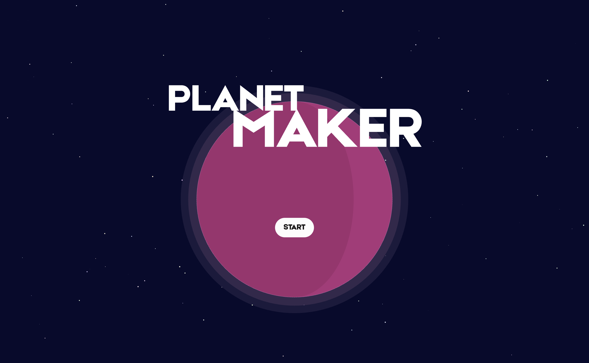
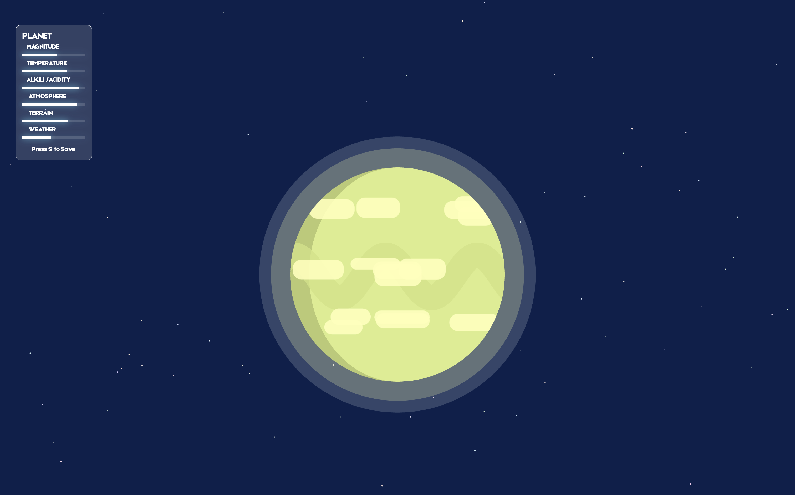
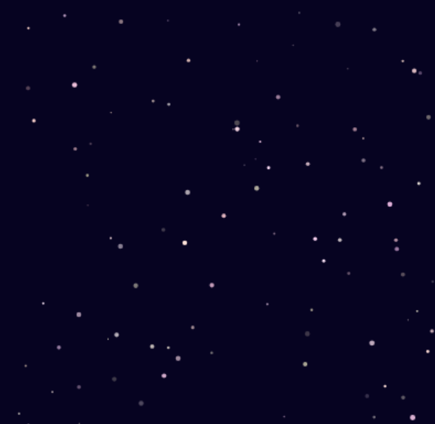
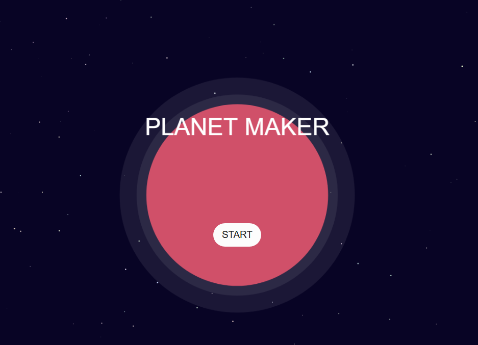
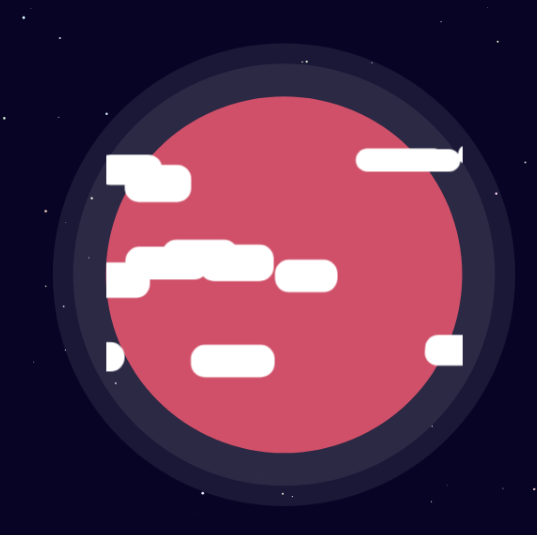

# Final Project — Planet Maker

<!-- Replace "Title" with the name of your project -->

---

### The Project

<!-- What is your project and what does it do?
     What experience does it create, and who or what does it respond to?
     A short paragraph is ideal — make it something you'd be happy for anyone to read. -->
Planet Maker is an interactive experience where you can create your own planet by adjusting its characteristics such as its size and temperature using sliders. As you customize its visuals, the melody it plays changes accordingly. Play around and create your own unique sounding world!
---

### Output

Title screen:



Playing screen:




<!-- Drop a screenshot or GIF of your project.
     Got more to show? Add more images — let the work speak for itself.
     Save everything to a readme-assets/ folder inside this project folder. -->

[Watch Online](https://youtu.be/4hgHZjjsU2Y)

<!-- Replace the link above with a URL to a screen recording or video of your final project.
     ⚠️ Make sure the file or page is set to public before submitting. -->


### WIPs

the first attempt at creating a starry background with a loop and randomizing their x,y positions and opacity









---

### ✍️ Reflection

<!-- 200–300 words on your process and outcome. Write freely — this is your story to tell.
     Some prompts to get you started:
     — What did you set out to create, and how did the final result compare to your original vision? X
     — How is your project structured — what inputs does it respond to and how did you approach the code?
     — What were your key visual and/or sonic design decisions, and why? X
     — What was your biggest challenge, and how did you work through it?
     — What would you change, add, or explore further given more time? -->


From the start, Isaac, Soonyu and I wanted to create something inspired by the game Outer Wilds as we liked the 'cozy outer space' feel it had. Our initial ideas included a space ship flying game which would incorporate Outer Wild's acceleration and drift-based mechanic. 

After I looked through the reference websites provided, I found that I particularly enjoyed those experiences that allowed you to experiment with settings to achieve different results, as I wanted to see what result the possible combinations could give me. Especially with music involved, they made for really fun and emotional experiences. Two websites that inspired our idea were [Chrome Music Lab](https://musiclab.chromeexperiments.com/) and [WebGL Fluid Simulation](https://paveldogreat.github.io/WebGL-Fluid-Simulation/). 

A visual style I suggested the group to emulate was that of Kurzgesagt's vector illustrations as I felt it was simple to create with the shapes on p5.js and the clean and solid colours felt suitable for a minimalist space game.

For the audio, we used a bass guitar, drums and synth and worked out which slider would change which aspect of the music like tempo and pitch.


---

<!-- ─────────────────────────────────────────────────────
     GOING FURTHER — want to document more? Try any of these:

     ### ✨ Features
     A short list of what your project does.
     - Responds to mouse position and velocity
     - Generates sound based on particle density

     ### 🔍 Code Structure
     How are your files organised?
     - `sketch.js` — main setup and draw loop
     - `Agent.js` — autonomous agent class
     - `assets/` — images and sounds

     ### 🛠️ Hardware (if applicable)
     List any physical components used.
     - Arduino Uno
     - Sensor type and model

     ### 🧩 Something I'm Proud Of
     A snippet, a decision, a moment where it all came together.
     ```js
     // your code here
     ```

     ### 🔗 References
     Tutorials, libraries, artworks, or research that informed your project.
     https://musiclab.chromeexperiments.com/
     https://paveldogreat.github.io/WebGL-Fluid-Simulation/
     https://vincentgarreau.com/particles.js/
     ───────────────────────────────────────────────────── --> 
